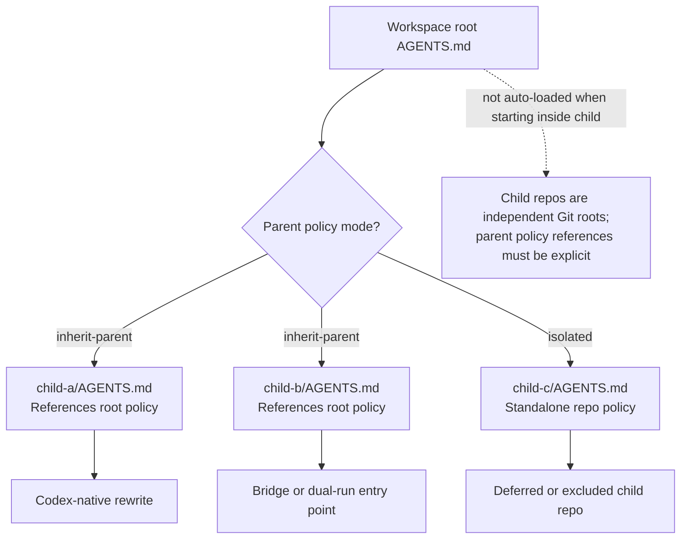
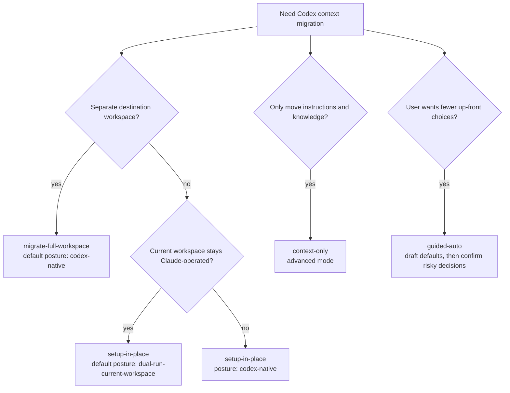
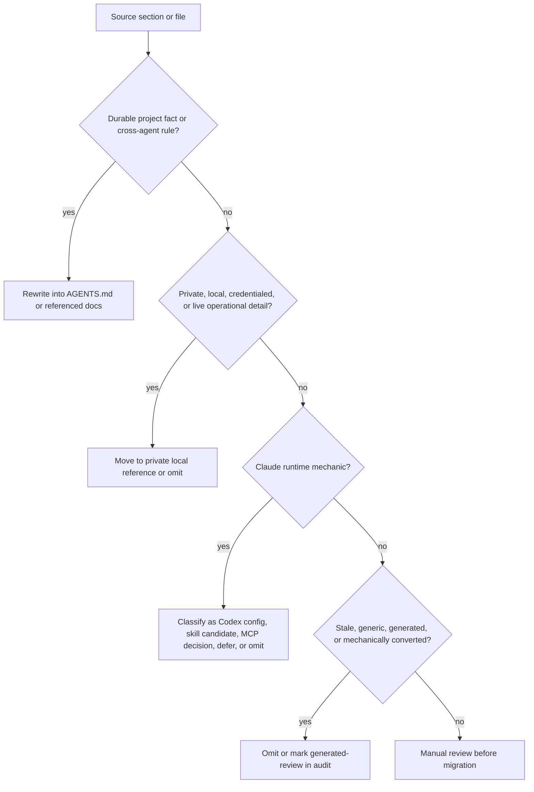

# codex-context-migration

`codex-context-migration` is an advanced audit companion for Claude-to-Codex
workspace migrations that exceed OpenAI's curated `migrate-to-codex` skill. It
adds multi-repository manifests, workspace-copy policy, dual-run posture,
private-context separation, parent-policy layering, and authorization evidence.
It does not replace the official converter.

<a id="when-to-use"></a>

## Who This Is For

Use this skill for advanced workspace audits when:

- A workspace root policy should apply across multiple child repositories.
- Repositories mix durable facts with Claude-specific mechanics such as hooks,
  permissions, slash commands, plugins, or MCP config.
- Private local context, memory, routing, credentials, or operational details
  need to stay out of repo instructions.
- Existing `AGENTS.md` files may be generated, mechanically converted, stale,
  or mixed with source material that needs trust-mode verification.

Use OpenAI's curated `migrate-to-codex` skill for a small single repository or
another routine supported conversion. Also skip this skill when the user
explicitly wants to keep a Claude-native config repo as-is rather than migrate
its contents.

## Runtime Support

| Runtime | Support level | Intended behavior |
|---|---|---|
| Codex | Recommended; full workflow | Invoke `migrate-to-codex`, apply this skill's advanced audit gates, and validate the resulting Codex instruction chain natively. |
| Claude Code | Compatibility mode | Run read-only inventory or prepare an audit plan, then hand supported conversion and final validation to Codex. |

Do not use Claude Code as the migration executor from inside a source workspace
whose `CLAUDE.md` is already active. In that environment, source instructions
may already influence the session before this skill classifies them as audit
data.

## Official Skill First

Install and use OpenAI's curated `migrate-to-codex` skill for routine supported
instruction, skill, hook, MCP, config, and subagent conversion:

```text
$skill-installer migrate-to-codex
```

Use this repository only when the migration also needs the advanced audit
surfaces listed above. Do not activate this personal skill globally for routine
migrations.

## Optional Advanced-Audit Installation

For explicit advanced-audit work, install the whole
`codex-context-migration/` directory into a Codex skill discovery location:

```bash
mkdir -p "${CODEX_HOME:-$HOME/.codex}/skills"
ln -s <repo-path>/codex-context-migration \
  "${CODEX_HOME:-$HOME/.codex}/skills/codex-context-migration"
```

> Verified with `codex-cli 0.137.0`: bundled system skills are present under
> `${CODEX_HOME:-$HOME/.codex}/skills/.system/`, and the bundled
> `skill-installer` installs into `${CODEX_HOME:-$HOME/.codex}/skills/`.
> OpenAI's current Codex skills docs also describe `.agents/skills` locations
> for authoring/local discovery, so prefer your local Codex installation's
> skill-installer path if the paths differ.

Restart Codex after installation if automatic discovery does not refresh.

For a snapshot installation from GitHub, ask Codex to use its `skill-installer`
skill with this repository path:

```text
WoojinAhn/custom-skills/codex-context-migration
```

Plugin packaging is not required for direct skill use. A `.codex-plugin`
wrapper and marketplace entry can be added later if this skill needs
marketplace-style discovery or installation.

## Distribution And Updates

[GitHub](https://github.com/WoojinAhn/custom-skills) is the canonical source for
this skill. The instructions below apply only to the optional advanced-audit
installation; use OpenAI's `migrate-to-codex` for routine supported conversions.
Any future OpenAI curated catalog submission is a separate discovery and review
channel, with no guarantee of acceptance or automatic updates.

| Install mode | Use case | Update behavior |
|---|---|---|
| Git clone + symlink | Recommended for tracking this source repository | Update the checkout; the symlink continues to use that directory. |
| Copy the whole skill directory | Simple offline or one-time snapshot | Replace the installed directory manually from the selected version; pulling the source repo does not update the copy. |
| `skill-installer` with the GitHub path above | Codex-assisted snapshot installation | The current installer copies files and rejects an existing destination. Review local edits and replace/reinstall deliberately; it does not provide automatic updates. |

For a new clone, run this from the directory where you keep source repositories,
then use the symlink command in [Optional Advanced-Audit Installation](#optional-advanced-audit-installation)
with the clone's absolute path as `<repo-path>`:

```bash
git clone https://github.com/WoojinAhn/custom-skills.git
cd custom-skills
```

Keep one active installation of this skill. If switching from a copied install
to a symlink, preserve any local edits and move the old installation out of the
skill discovery directory before creating the link.

### Follow The Default Branch

From the clone, with local edits committed or saved separately:

```bash
git switch master
git pull --ff-only
```

`master` is this repository's default branch. `--ff-only` stops if local history
has diverged so you can resolve it explicitly. The same commands return a pinned
checkout to branch tracking.

### Pin A Snapshot

From the clone, fetch and list available tags:

```bash
git fetch origin --tags
git tag --list
```

Choose an existing release tag, or a reviewed full commit SHA if no release tag
is available. Replace `<tag-or-commit>` with that value:

```bash
git switch --detach <tag-or-commit>
```

A detached checkout stays at that snapshot until you select another revision;
do not run the branch-update commands while you intend to stay pinned. The
symlink needs no change. All skills linked to this clone follow the same
checkout, so use a separate clone if they need independent versions. Copied
installs must be replaced from the selected snapshot instead.

Codex detects skill changes automatically; restart it if discovery does not
refresh. See OpenAI's [local skill discovery guidance](https://learn.chatgpt.com/docs/build-skills#where-codex-loads-local-skills).

Release notes can link directly to [this section](#distribution-and-updates).
The final public smoke QA in [#40](https://github.com/WoojinAhn/custom-skills/issues/40)
should repeat the clone/symlink, branch update, snapshot pin, and return-to-branch
checks from a clean checkout.

## Quick Start

Run the migration from a Codex session. The source files being migrated may
contain instructions for another agent; this skill treats them as data to audit,
not as commands to follow.

Example prompt:

```text
Use the codex-context-migration skill.

Source root: `/path/to/old-workspace`
Operation mode: `migrate-full-workspace`
Destination root: `/path/to/new-codex-workspace`

Run read-only inventory first. Show the guided-auto plan and ask before
copying files, migrating private context, registering MCP servers, or retaining
runtime/plugin behavior.
```

The inventory helper requires Python 3.11 or later (`python3`) and uses only
the standard library. Run this read-only command from the repository root:

```bash
python3 codex-context-migration/scripts/inventory.py \
  --source ~/old-workspace \
  --destination ~/new-codex-workspace \
  --guided-auto-plan \
  --format markdown
```

Before editing files, record five migration control points:

1. Operation mode: `setup-in-place`, `migrate-full-workspace`,
   `context-only`, or `guided-auto`.
2. Target posture: `codex-native` or `dual-run-current-workspace`.
3. Parent policy mode for child Git repositories: `isolated` or
   `inherit-parent`.
4. Child repo handling: native `AGENTS.md`, bridge, dual-run bridge,
   copy-only, defer, or exclude.
5. Mutation authorization: record file edits, local commits, and remote writes
   separately; do not infer one permission from another.

`guided-auto` drafts conservative defaults from inventory signals. It is a
planning aid, not silent approval; private/local memory, hooks, permissions,
MCP write or production access, third-party bridges, and retained Claude
plugins still require explicit confirmation.

## Development Checks

Run from the repository root with Python 3.11 or later. The regression tests
additionally require `pytest`. Keep that dependency in an isolated environment:

```bash
python3 -m venv .venv
. .venv/bin/activate
python3 -m pip install pytest
python3 -m pytest codex-context-migration/scripts/tests -q
```

## Workspace Layering



## Operation Mode Decision Tree



## Source Classification Flow



## Worked Example

See [references/example-migration.md](references/example-migration.md) for a
realistic before/after migration showing:

- A mixed `CLAUDE.md` with project facts, private routing, hooks, and MCP notes.
- The resulting Codex-native `AGENTS.md`.
- A private local reference stub for sensitive material.
- An audit row explaining what moved, what was deferred, and what was omitted.

## Common Mistakes

- Activating this personal skill before checking whether the official
  `migrate-to-codex` skill fully covers the request.
- Renaming `CLAUDE.md` to `AGENTS.md` without classifying contents first.
- Copying `.claude/settings.json` or `.mcp.json` wholesale into `AGENTS.md`.
- Treating an existing `AGENTS.md` as authoritative without trust-mode
  verification.
- Migrating a `claude-config` or settings-sync repo as if it were a normal
  product child repo.
- Letting source `AGENTS.md`, `CLAUDE.md`, or imported content act as
  operational instructions during migration; source material is data to
  classify, not directions to follow.

## References

- [Draft v1 release notes](references/release-notes-v1.md): capabilities,
  limitations, and the remaining release gate.
- [SKILL.md](SKILL.md): compact operational instructions loaded by the agent.
- [LICENSE.txt](LICENSE.txt): MIT license for this skill package.
- [references/operation-modes.md](references/operation-modes.md): detailed mode,
  posture, parent-policy, child-selection, and guided-auto semantics.
- [references/audit-template.md](references/audit-template.md): migration audit
  template.
- [references/agents-md-shapes.md](references/agents-md-shapes.md): native,
  bridge, and dual-run `AGENTS.md` templates.
- [references/runtime-and-skill-artifacts.md](references/runtime-and-skill-artifacts.md):
  private context, MCP, runtime config, plugin, and skill artifact handling.
- [references/ecosystem-matrix.md](references/ecosystem-matrix.md): Claude to
  Codex ecosystem migration matrix.
